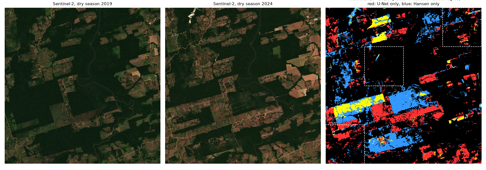
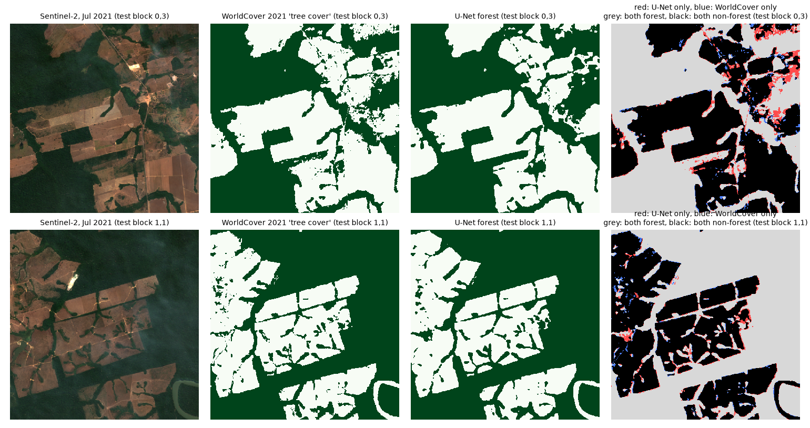

# Deforestation Detection from Sentinel-2 (U-Net + change detection)

A U-Net maps forest cover from free Sentinel-2 satellite imagery. Running it on the same area
in 2019, 2021 and 2024 and comparing the maps flags **newly cleared forest**, shown on an
interactive Leaflet map. The study area is 22 × 22 km around Novo Progresso (Pará, Brazil)
on the BR-163 highway, one of the most active deforestation fronts in the Amazon.

New to this? Start with **[LESSON.md](LESSON.md)**: concepts first, then a code walkthrough.

**Interactive map:** [`results/deforestation_map.html`](results/deforestation_map.html).
Download it and open it in a browser. GitHub shows the source, not the map.



## Data and labels (all free, no accounts)

| what | source | used for |
|---|---|---|
| Sentinel-2 L2A, 10 m, 6 bands | AWS Earth Search STAC (Cloud-Optimized GeoTIFFs) | model input; 4 cloud-free dry-season scenes per year (Jun–Aug 2019, 2021, 2024), median composite |
| **ESA WorldCover 2021** v200, 10 m | AWS open data | **training labels**: forest = class 10 "tree cover" |
| **Hansen Global Forest Change** v1.12, 30 m | Google Cloud public bucket | **independent check only**: year of tree-cover loss 2001–2024. Never used for training or tuning |

**Labelling approach, stated plainly:** the U-Net learns to reproduce WorldCover's
"tree cover" class from Sentinel-2 pixels. It never sees a human-drawn label. WorldCover is
itself a model output (ESA reports about 77% overall accuracy globally), so "accuracy" below means
"agreement with WorldCover", not ground truth.

## Results

### 1. Forest map, 2021 (3 held-out test blocks, 92 km², never seen in training)

| method | IoU (forest) | precision | recall | pixel accuracy |
|---|---:|---:|---:|---:|
| **U-Net** (8 input channels, 1.1 M parameters) | **0.900** | 0.941 | 0.954 | 94.6% |
| NDVI > 0.57 (threshold tuned on training blocks) | 0.871 | 0.934 | 0.928 | 93.0% |



The U-Net beats a single-number vegetation index by 3 IoU points. Most remaining disagreement
is at field edges and in narrow strips of riverside forest.

**Spatial split.** The area is cut into a 4 × 4 grid of 5.5 km blocks: 11 for training,
2 for validation, 3 for test. Neighbouring pixels are almost identical, so splitting pixels
at random would leak; whole blocks are held out instead.

### 2. Newly cleared forest vs Hansen (2019 → 2024)

A pixel is "newly cleared" if the model calls it forest in the first year and not forest in
the second. Patches under 0.5 ha are dropped as noise. Agreement uses a 1-pixel tolerance,
because Hansen is 30 m and we are 10 m.

| scored on | method | precision | recall | F1 | flagged area |
|---|---|---:|---:|---:|---:|
| land Hansen counted as **intact forest** in 2019 | **U-Net** | **0.94** | 0.23 | 0.37 | 1,505 ha |
| same | NDVI threshold | 0.87 | 0.23 | 0.37 | 1,508 ha |
| whole area | U-Net | 0.25 | 0.23 | 0.24 | 6,375 ha |

**Plain reading:** when the model says intact forest was cleared, it is almost always right
(94% confirmed by Hansen). But it finds less than a quarter of what Hansen calls loss. On
change detection, **the U-Net is no better than the NDVI baseline**: both make the same misses.

### Why the agreement looks so low on the whole area, and what each side misses

The two datasets answer slightly different questions, and the code measures both kinds of
disagreement (`results/metrics.json`):

- **U-Net flags that Hansen can't confirm (red on the map figure): 94% are on land Hansen had
  already marked as lost before 2019.** That's pasture or regrowth being cleared again.
  Hansen keeps one loss year per pixel, so re-clearing is invisible to it. These flags may
  well be real; they just can't be checked with Hansen.
- **Hansen loss the U-Net misses (blue): the U-Net still says "forest" there with 95% mean
  confidence in 2024.**
  - 39% of it is 2024 loss. Our 2024 image is from June/July; most 2024 loss came in the
    August–September fire season, after it.
  - Much of the rest looks like **fire-damaged forest** in the 2024 image: brown, patchy
    canopy that is still standing. Hansen counts canopy loss from fire as loss. WorldCover,
    and so our model, still calls a burnt but standing forest "tree cover".
- So this model detects **clear-cutting**, not degradation. Telling burnt forest apart from
  intact forest would need different labels, such as burn scars or Hansen loss itself.

### Shorter intervals are much worse

For 2019→2021 and 2021→2024 separately, the U-Net's recall against Hansen on intact forest
is only 5–6% (precision 0.50 and 0.85). Losses smaller than a whole field, and timing
mismatches at both ends of each interval, dominate when the interval is short. The NDVI
baseline has much better recall for 2019→2021 (35%). See `results/metrics.json`.

### Forest fraction of the area (U-Net)

2019: **73%** → 2021: **65%** → 2024: **62%**. Hansen's forest (≥30% cover in 2000, not yet
lost) is lower in every year (54% → 50% → 40%), because WorldCover and the U-Net count
regrowth as tree cover and Hansen doesn't.

## Bugs found on the way (kept because they're instructive)

1. **Double-counted reflectance offset.** Sentinel-2 data processed since 2022 has +1000 added
   to every value. Earth Search removes it for many scenes (`earthsearch:boa_offset_applied`)
   but still lists `offset: -0.1` in the metadata. Applying it again made 9 of 12 scenes 0.1
   too dark (negative reflectance), which would have faked change between years. Fixed and
   covered by a test.
2. **GDAL turned real zeros into ones.** Declaring 0 as "no data" when warping Hansen's
   loss-year file (where 0 means "no loss") made GDAL quietly nudge every real 0 to 1,
   i.e. "lost in 2001", on half the area. Fixed by only declaring no-data when the source has one.

## How it works

1. `scripts/download_data.py`: queries the STAC catalogue, picks the clearest dry-season dates
   for each year (the area straddles two Sentinel-2 tiles, so both tiles per date), reads
   **only the pixels inside the area** from each cloud-optimized GeoTIFF over HTTP, masks
   clouds with the scene classification layer, takes a per-pixel median, and resamples
   WorldCover and Hansen onto the same 10 m grid. About 250 MB of traffic.
2. `scripts/train.py`: random 128 × 128 patches from training blocks, with rotations, flips
   and brightness jitter. U-Net with 8 input channels (6 bands + NDVI + NBR). Loss is
   binary cross-entropy + Dice. The best validation-IoU epoch is kept (epoch 25 of 40,
   ~16 min on an M1 GPU).
3. `scripts/evaluate.py`: forest maps for all years, change masks, and every number above.
4. `scripts/make_map.py`: the Folium/Leaflet HTML map with toggleable layers.

## Honest notes

- **One area, one model.** All results come from one 22 km area. A different biome (or even
  a different part of the Amazon) would need checking.
- **Labels are model outputs.** Training labels (WorldCover) and the check (Hansen) are both
  products of other models, with their own errors and definitions of "forest".
- **The map's HTML was checked structurally** (all layers, 875 patches, embedded images),
  not by opening it in a browser in this build environment. Open it yourself to judge it.
- **Test-block change scores are noisy**: the 3 test blocks hold only 358 ha of Hansen loss.

## Reproduce

Needs [uv](https://docs.astral.sh/uv/) and Python 3.12. Runs on CPU, or on the GPU via MPS
(Apple Silicon). About 250 MB downloaded, 600 MB on disk.

```bash
git clone https://github.com/Nipuna-Lakruwan/sentinel2-deforestation-unet.git
cd sentinel2-deforestation-unet && uv sync
uv run python scripts/download_data.py   # ~30 min at 1.3 MB/s; raw scenes are cached
uv run python scripts/train.py           # ~16 min on an M1 GPU
uv run python scripts/evaluate.py
uv run python scripts/make_map.py        # -> results/deforestation_map.html
uv run pytest
```

## Resume bullet

> Built a deforestation monitoring pipeline on free Sentinel-2 imagery (STAC + Cloud-Optimized
> GeoTIFFs): a PyTorch U-Net maps forest at 0.90 IoU on spatially held-out test blocks, and
> multi-date change detection of clear-cut forest was 94% precise against Hansen Global Forest
> Change (recall 23%; fire damage is missed), visualized on an interactive Leaflet map.

## Data licences

Sentinel-2: Copernicus open licence (contains modified Copernicus Sentinel data 2019–2024).
ESA WorldCover: CC BY 4.0. Hansen/UMD/Google/USGS/NASA Global Forest Change: CC BY 4.0. Code: MIT.
